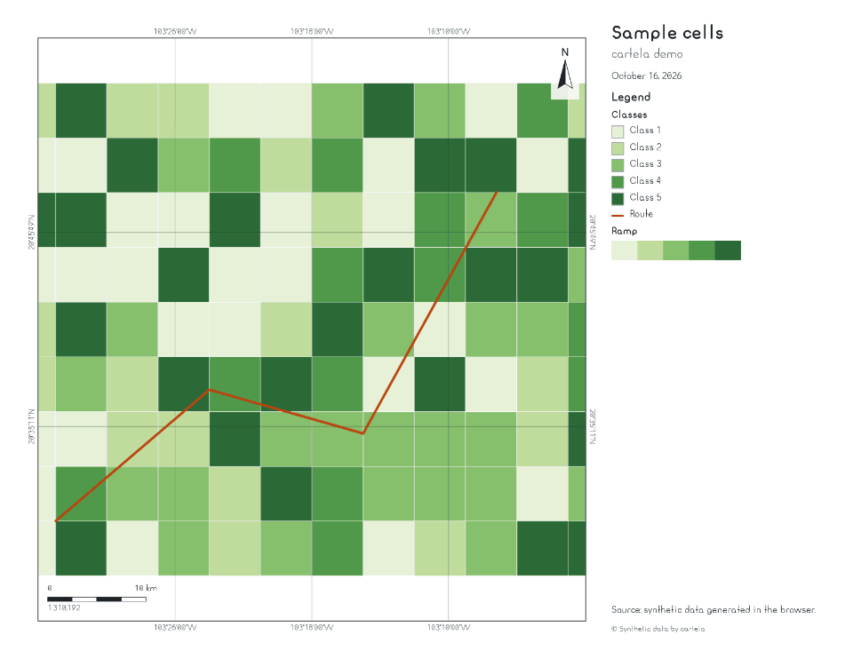

# <picture><source media="(prefers-color-scheme: dark)" srcset=".github/assets/icon-dark.svg"></picture> cartela

[](https://www.npmjs.com/package/cartela)
[](https://bundlejs.com/?q=cartela)
[](LICENSE)

Headless print and video export for OpenLayers maps: sheet, legends, scale bar, graticule, PNG, PDF, MP4 and GIF.



**[Live demo](https://ghegar.github.io/cartela/)**

cartela owns the render: it sizes a canvas for paper and DPI, draws the live
[OpenLayers](https://openlayers.org) map straight into it, restores the map afterwards and composes
the sheet around it — title, legend, scale bar, north arrow, grid, overview map, attributions. It also
records the map frame by frame along a route or around a centre. You own the dialog: it ships no CSS,
no brand and no UI, only canvases, blobs and a frame rectangle that you draw yourself.

## Install

```bash
npm install cartela ol
```

| Entry | What it is | Needs |
|---|---|---|
| `cartela` | Framework-free core: render, sheet layout, elements, preview, print frame, PNG and PDF | `ol >= 10` |
| `cartela/video` | Frame plans, recording, trail and encoders for MP4, WebM and GIF | `mediabunny >= 1.61`, `gifenc >= 1.0.3` |
| `cartela/react` | `useMapExport`, `usePrintFrame` and `useMapVideo` | `react >= 19` |

## Quick start

```ts
import { attribution, exportMap, legend, northArrow, saveBlob, scaleBar, title, toPdf, wmsLegends } from 'cartela';

const sheet = await exportMap(map, {
    page: { size: 'a4', orientation: 'landscape', dpi: 200 },
    layout: 'right',
    elements: [
        title('Population 2020'),
        legend(wmsLegends(map), { title: 'Legend' }),
        attribution(),
        scaleBar({ ratio: true }),
        northArrow(),
    ],
});
saveBlob(await toPdf(sheet, { title: 'Population 2020' }), 'map.pdf');
```

## Page and layout

| Option | Values |
|---|---|
| `page.size` | `letter`, `legal`, `tabloid`, `a5`, `a4`, `a3`, `a2` or `[width, height]` in mm |
| `page.orientation` | `landscape` (default) or `portrait` |
| `page.dpi` | Any number, or a preset of `QUALITY`: `draft` 72, `normal` 150, `high` 300, `ultra` 400 |
| `page.margin` | Millimetres around the content (8 by default) |
| `layout` | `right`, `left` (a side panel), `bottom` (a band) or `none`; as an object, `{ kind, panel, gap, columns }` |
| `maxPixels` | Pixel budget of the page (4096² by default); a larger request lowers the DPI and reports `geometry.clamped` |
| `theme` | Font family and sizes in points, colours, frame width and gap in mm. The default theme is neutral |
| `extent` | What goes inside the frame: `'frame'` (default, the print frame on screen), `'view'`, an `Extent` or `{ center, resolution }` |
| `fit`, `rotation` | `contain` or `cover`; `rotation` overrides the view |
| `freeze` | While the map renders off-screen the page shows a frozen image of it (`true` by default) |

The map pixel ratio is `dpi / 96`, so layers shown by resolution and symbol sizes come out on paper as
you see them. `renderMap` gives a bare snapshot without a sheet.

## Elements

Every element is a function that returns a `SheetElement` and goes into `elements`. Each one lives in a
slot:

| Slot | Where | Elements |
|---|---|---|
| `panel` | The side panel or the bottom band, in reading order | `title`, `text`, `dateText`, `image`, `legend`, `attribution` (default slot) |
| `map` | A corner over the map, with a halo | `scaleBar`, `northArrow`, `overviewMap` (default slot); text, image and attribution with `slot: 'map'` |
| `frame` | Around the frame edge | `grid`, `graticule` |

```ts
dateText({ locale: 'en-GB', prefix: 'Printed ' });
text(env => `1:${Math.round(env.snapshot.resolution)}`, { slot: 'map', position: 'top-left' });
image('/logo.png', { width: 30, align: 'right' });
scaleBar({ ratio: true, segments: 4, width: 40 });
graticule({ crs: 'utm', zone: 'auto', interval: 5000, sides: ['bottom', 'left'] });
overviewMap({ layers: () => [new TileLayer({ source: new OSM() })], position: 'bottom-right', size: 35, factor: 8 });
```

Text content can be a function of the draw environment. `position` takes `top-left`, `top-right`,
`bottom-left` or `bottom-right`.

| Element | Behavior |
|---|---|
| `legend` | Headings, symbols (`box`, `line` or `circle` with `fill` and `stroke`), images or WMS `GetLegendGraphic` entries; `wmsLegends(map, params)` builds one per visible WMS layer. It grows to fill the panel; what does not fit moves to extra pages, in columns as wide as the panel, and the elements after it keep their order |
| `scaleBar` | Metres or kilometres; `ratio` adds the representative fraction (`1:310,192`); `segments`, `width`, `locale`. `scaleMeasure` exposes the numbers for your own element |
| `northArrow` | Turns with the view rotation |
| `grid` | Divides the frame into equal parts (`divisions: [4, 3]`) and labels the edges in degrees (`format: 'dms'` or `'decimal'`) |
| `graticule` | Lines at round values in lon/lat, UTM or any projection registered in OpenLayers, labelled where they cross the edge. It samples the border, so it stays correct with a rotated view. UTM uses the Krüger series on WGS 84 without proj4; `toUtm`, `fromUtm` and `utmZone` are exported |
| `overviewMap` | A second map with the frame footprint. `layers` is a factory because a layer cannot live in two maps; `extent` fixes the area (default: `factor` times the frame) and `footprint` styles the rectangle. In a video it renders once |

### Layer legends

`legend` also takes plain legend data with a `kind`, the shape a layer manager can produce without
depending on cartela:

```ts
legend([
    { kind: 'classes', layerId: 'hex', title: 'Crimes', classes: [{ label: '0 – 10', color: '#fde8d0', count: 42 }] },
    { kind: 'ramp', layerId: 'ndvi', title: 'NDVI', stops: [{ value: -1, color: '#a50026' }, { value: 1, color: '#006837' }] },
    { kind: 'image', layerId: 'rivers', title: 'Rivers', url: legendUrl },
    { kind: 'symbols', layerId: 'roads', title: 'Roads', items: [{ label: 'Highway', color: '#333', shape: 'line' }] },
], { histogram: true, format: v => v.toLocaleString('en') });
```

Each one gets its `title` as a heading. `classes` draw as color boxes, or with `histogram: true` (or
`histogram` on the entry) as bars proportional to `count` with the count beside them. `ramp` draws a
gradient bar with its end values (`format` formats them), `image` loads `url` like a WMS legend, and
`symbols` maps `point`, `line` and `fill` to circle, line and box.

### Custom elements

Anything that implements `SheetElement` goes on the sheet: `measure` gives the height in a panel,
`size` the box in a corner, `load` fetches what it needs before drawing, `reserve` claims space around
the frame, and `draw(ctx, box, env)` may return the rest of the element to continue on the next box or
page (or `null`).

## Preview and print frame

```ts
const preview = await previewMap(map, { page: { size: 'a4' } });
const stop = watchPrintFrame(map, { page: { size: 'a4' } }, frame => setGuide(frame));
```

`previewMap` runs the same pipeline at 60 DPI. `printFrame` returns the on-screen rectangle that will
be printed and `watchPrintFrame` keeps it updated; you draw the guide.

## Output

| Function | Gives |
|---|---|
| `toBlob(sheet, type, quality, page)` | One page as PNG, JPEG or WebP |
| `toBlobs(sheet, type, quality)` | Every page |
| `toPdf(sheet, { title, author, date, quality })` | A PDF with JPEG pages, written by cartela with no dependencies |
| `saveBlob(blob, filename)` | Download through a temporary link |

`exportMap` takes a `signal` to cancel and `onProgress`, which reports the phase (`layout`, `render`,
`load`, `compose`, `encode`) and a ratio. Errors are typed: `TaintedCanvasError` (with the suspect
layers), `RenderTimeoutError` and `UnsupportedFormatError`, all subclasses of `CartelaError`.

## Video

```bash
npm install mediabunny gifenc
```

```ts
import { attribution, northArrow, saveBlob, scaleBar, title } from 'cartela';
import { gifEncoder, pickFormat, planRoute, recordMap, recordingDefaults, videoEncoder, videoSupport } from 'cartela/video';

const format = pickFormat('mp4', await videoSupport());
if (!format) throw new Error('No video format available');
const { fps, size } = recordingDefaults(format);
const plan = planRoute(map, route, { fps, size, duration: 12, rotate: true });

const video = await recordMap(map, plan, {
    encoder: format === 'gif' ? gifEncoder() : videoEncoder({ container: format, quality: 'high' }),
    elements: [title('Route', { slot: 'map' }), scaleBar(), northArrow(), attribution({ slot: 'map' })],
    trail: { route },
});
if (video.blob) saveBlob(video.blob, `route${video.extension}`);
```

| Feature | API |
|---|---|
| Follow a `LineString` at constant ground speed, with `follow`, `rotate`, `zoom`, `hold` and `easing` | `planRoute` |
| Orbit around a centre (`turns`, `direction`) | `planOrbit`, or any `FramePlan` of your own |
| Hold the current view, for time-lapses of WMS layers | `planHold` |
| Change the map before each frame (a date, a filter, a layer) | `beforeFrame` |
| Deterministic recording: every frame waits for the map to finish rendering | `recordMap` |
| Growing trail and heading marker over the route | `trail` |
| Sheet elements over every frame; scale bar and north arrow follow the view | `elements` (`map` and `frame` slots) |
| MP4 and WebM through WebCodecs, GIF as a fallback | `videoEncoder`, `gifEncoder`, or your own `EncoderFactory` |
| Support detection and format fallback | `videoSupport`, `pickFormat`, `UnsupportedFormatError` |
| Write straight to disk: `video.blob` comes back `null`, MP4 keeps fast start with `fastStart: 'reserve'` and a cancelled recording aborts the stream | `target` (a `WritableStream` of positioned chunks, such as `showSaveFilePicker` returns), `fileTarget`, `canPickFile` |

`recordingDefaults` gives 30 fps at 1280×720 for MP4 and WebM, and 15 fps at 480×480 for GIF. The
size is rounded to even numbers, and panel elements are rejected: use `slot: 'map'` for titles and
text. `mediabunny` and `gifenc` are loaded with a dynamic `import()` only when a video is recorded;
print-only apps never load them.

### Animating dates

With [zootropo](https://github.com/GHEgar/zootropo) driving a WMS layer, hold the view and move one
step every few frames; `recordMap` waits for the tiles of each step before encoding it:

```ts
const keys = player.getSnapshot().sequence.keys;
const plan = planHold(map, { fps: 10, frames: keys.length * 5 });
const video = await recordMap(map, plan, {
    encoder: gifEncoder(),
    elements: [title(() => format.keys(player.getSnapshot().keys), { slot: 'map' })],
    beforeFrame: (_, index) => player.seek(keys[Math.floor(index / 5)] ?? keys[0]),
});
```

## React

```tsx
import type OlMap from 'ol/Map.js';
import { saveBlob, toPdf, type ExportOptions } from 'cartela';
import { useMapExport, usePrintFrame } from 'cartela/react';

export function PrintDialog({ map, options }: { map: OlMap; options: ExportOptions }) {
    const frame = usePrintFrame(map, options);
    const job = useMapExport(map);
    const save = async () => {
        const sheet = await job.run(options);
        if (sheet) saveBlob(await toPdf(sheet), 'map.pdf');
    };
    return (
        <>
            {frame && <div className="guide" style={{ left: frame.x, top: frame.y, width: frame.width, height: frame.height }} />}
            <button type="button" onClick={save} disabled={job.status === 'running'}>Print</button>
            {job.status === 'running' && <button type="button" onClick={job.cancel}>Cancel</button>}
        </>
    );
}
```

`useMapExport` and `useMapVideo` expose `status`, `progress`, `error`, the result (`sheet` or
`video`), `run`/`record`, `cancel` and `reset`. `usePrintFrame` returns the frame rectangle and
follows the map size and the sheet proportions.

## Known limitations

- Raster sources must load with `crossOrigin: 'anonymous'`; otherwise the canvas is tainted and
  `exportMap` throws `TaintedCanvasError`.
- A video takes longer than its duration: every frame waits for the map to render, so no frame is
  dropped. A recording is capped at 3 600 frames (`maxFrames`).
- MP4 and WebM depend on WebCodecs in the browser; check `videoSupport()` and fall back to GIF.
- The legend overflows onto at most 24 pages.

## Development

```bash
npm test
npm run lint
npm run typecheck
npm run demo
npm run e2e
```

The demo runs without network on synthetic cells and a route: layouts, quality presets, grid,
lon/lat and UTM graticules, overview map, a long legend that overflows, the print frame guide, PNG and
PDF downloads, and route or orbit recordings in MP4, WebM or GIF, optionally straight to disk.

## Contributing

Issues are welcome. Open one before sending a pull request.

## License

AGPL-3.0-only © GHEgar
